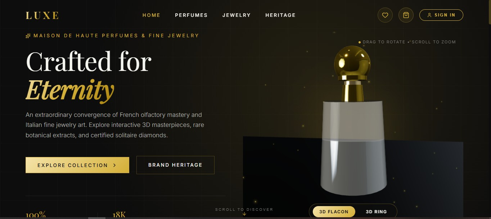
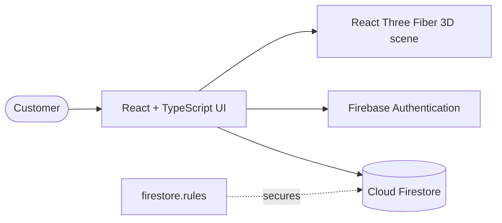

<div align="center">

# LUXE

**3D luxury perfume & jewellery storefront**

Inspect every piece in interactive 3D, then take it all the way to checkout.


[**Live Demo**](https://luxe-studio-1.ai.studio) &nbsp;·&nbsp; [Report an issue](https://github.com/RanaHaseebUrRehman11-stack/luxe-3d-ecommerce/issues)



</div>

## About

Luxury brands sell atmosphere as much as product. A flat grid of thumbnails undersells a fragrance or a diamond ring.

LUXE is an e-commerce storefront built around that idea. Customers can rotate and zoom each piece as a 3D model, then browse, save favourites, add to cart and check out, all inside one polished, responsive interface.

## Features

| Feature | Details |
|---|---|
| Interactive 3D product viewer | Drag to rotate, scroll to zoom, and switch between a 3D flacon and a 3D ring |
| Google Sign-In | Quick, secure authentication through Firebase |
| Cart, wishlist and checkout | The complete purchase journey, from browsing to checkout |
| Admin panel | Back-office view for managing the store |
| Responsive luxury UI | Gold-on-black editorial design across the Home, Perfumes, Jewelry and Heritage sections |

## Architecture



## Tech Stack

| Area | Technology |
|---|---|
| Frontend | React, TypeScript |
| Build tool | Vite |
| 3D rendering | React Three Fiber (Three.js) |
| Authentication | Firebase Authentication (Google Sign-In) |
| Database | Cloud Firestore, protected by security rules |

## Getting Started

**Prerequisites:** Node.js 18 or newer and npm (Bun also works, a `bun.lock` file is included).

```bash
# Clone the repository
git clone https://github.com/RanaHaseebUrRehman11-stack/luxe-3d-ecommerce.git
cd luxe-3d-ecommerce

# Install dependencies
npm install

# Start the development server (open the URL printed in the terminal)
npm run dev
```

Production build:

```bash
npm run build
npm run preview
```

## Configuration

1. Copy `.env.example` to `.env.local` and fill in the values. Environment files are git-ignored and must never be committed.
2. Firebase web configuration lives in `firebase-applet-config.json`. To run your own copy, create a Firebase project, enable **Google** as a sign-in provider, create a Firestore database, deploy the rules from `firestore.rules`, and replace the values in that file.

## Project Structure

```
├── src/                          # Application source (React + TypeScript)
├── assets/                       # Static assets
├── screenshots/                  # README images
├── firestore.rules               # Firestore security rules
├── firebase-applet-config.json   # Firebase web app configuration
├── firebase-blueprint.json       # Data model blueprint
├── .env.example                  # Environment variable template
├── index.html
├── vite.config.ts
├── tsconfig.json
└── package.json
```

## Roadmap

- [ ] Payment gateway integration
- [ ] Order history and tracking for customers
- [ ] Product search and filtering

## Author

**Rana Haseeb Ur Rehman** — Full-Stack Developer

[GitHub](https://github.com/RanaHaseebUrRehman11-stack) &nbsp;·&nbsp; [LinkedIn](https://www.linkedin.com/in/rana-haseeb-ur-rehman-ba3aa729b) &nbsp;·&nbsp; [Email](mailto:RanaHaseebUrRehman11@gmail.com)